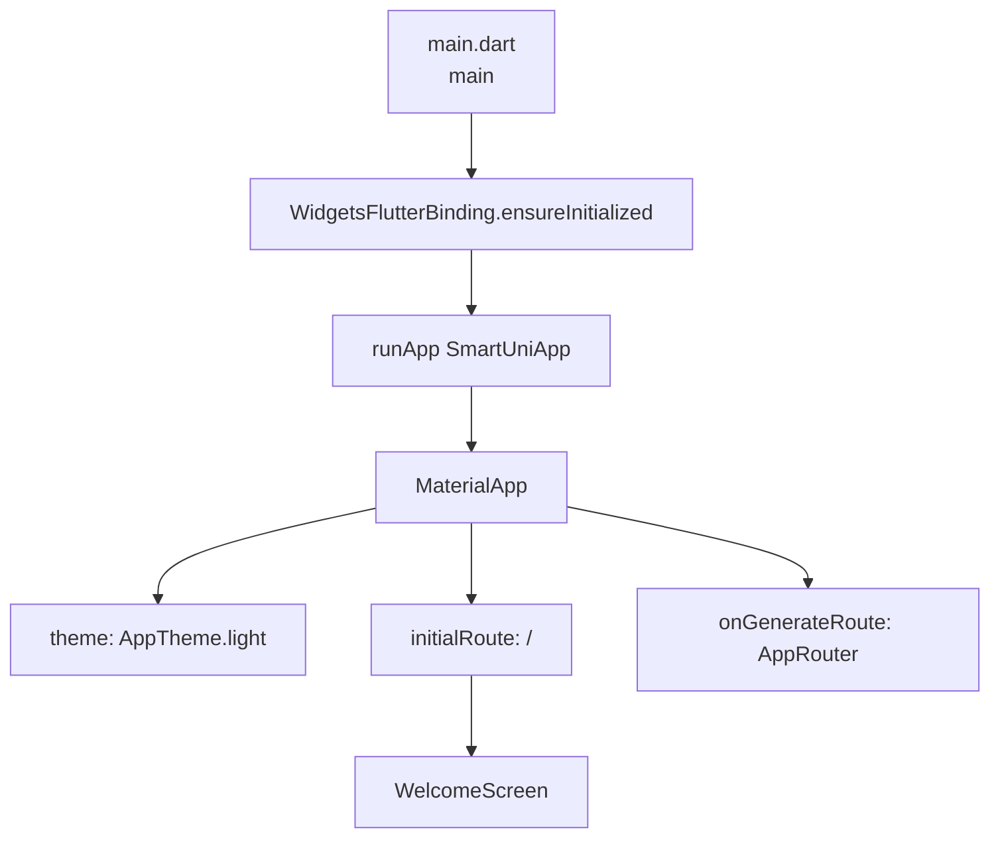
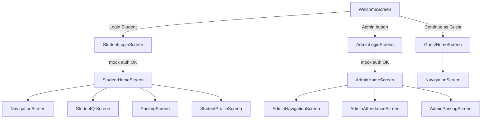
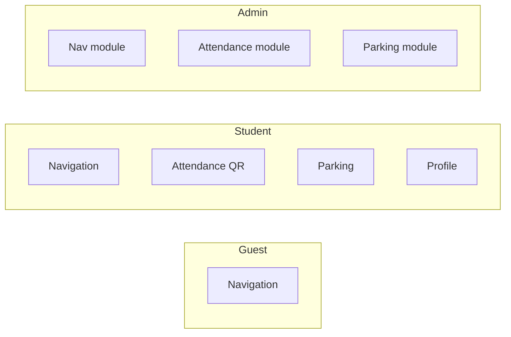
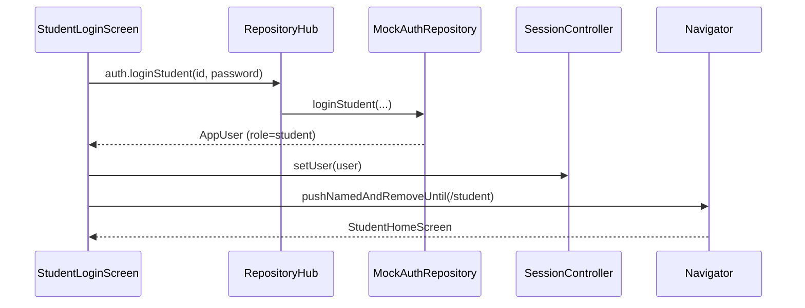
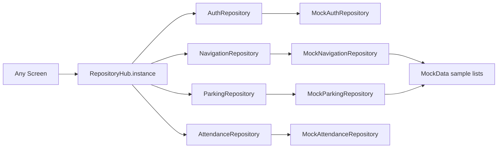
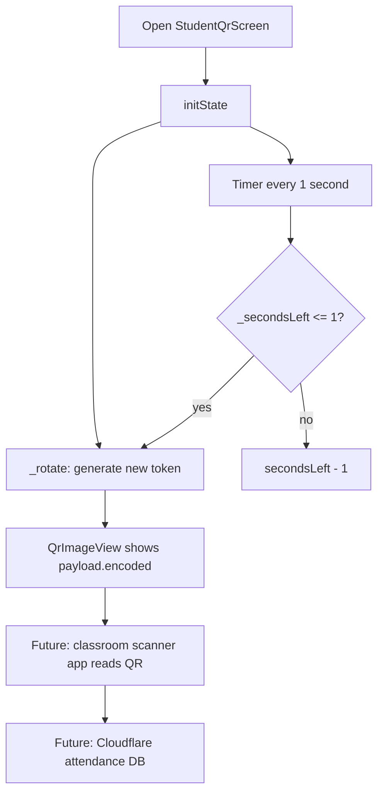
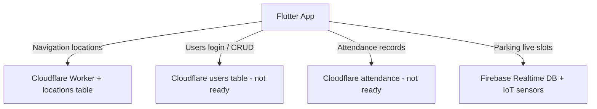

# SmartUni Frontend — Complete Code & Architecture Guide

This document explains **every active part** of the Step 1 Flutter app: why the folders exist, how data moves, how screens connect, and what each file does.

> **Active code:** everything under `Frontend/lib/` except `lib/_legacy/`  
> **Legacy folder:** old prototype screens — **not used** by `main.dart`. Ignore it while learning the new architecture.

---

## Table of contents

1. [Big picture (what this app is)](#1-big-picture-what-this-app-is)
2. [Architecture layers](#2-architecture-layers)
3. [Folder map](#3-folder-map)
4. [Flowcharts](#4-flowcharts)
5. [Core concepts (OOP patterns used)](#5-core-concepts-oop-patterns-used)
6. [File-by-file explanation](#6-file-by-file-explanation)
7. [How a button click travels through the code](#7-how-a-button-click-travels-through-the-code)
8. [What is mock vs real (Step 1)](#8-what-is-mock-vs-real-step-1)
9. [Glossary](#9-glossary)

---

## 1. Big picture (what this app is)

Smart University is a **Flutter mobile/web app** for City University (Abi Samra).

**Three roles:**

| Role | How they enter | What they can open |
|------|----------------|--------------------|
| Guest | “Continue as Guest” | Navigation only |
| Student | Student login | Navigation + Attendance QR + Parking + Profile |
| Admin | Admin login | Module screens for Navigation / Attendance / Parking |

**Step 1 goal:** professional structure + beautiful screens you can click through.  
**Data today:** fake (mock) data inside the app.  
**Later steps:** replace mocks with Cloudflare (navigation, users, attendance) and Firebase (parking IoT).

---

## 2. Architecture layers

Think of the app as **4 layers**. Upper layers may call lower layers. Lower layers must **not** know about screens.

```text
┌─────────────────────────────────────────────────────────┐
│  FEATURES (screens the user sees)                       │
│  auth / guest / student / admin / navigation / …        │
└───────────────────────────┬─────────────────────────────┘
                            │ uses
┌───────────────────────────▼─────────────────────────────┐
│  APP (shell)                                            │
│  MaterialApp · theme · named routes                     │
└───────────────────────────┬─────────────────────────────┘
                            │ uses
┌───────────────────────────▼─────────────────────────────┐
│  CORE (shared brain)                                    │
│  config · enums · models · session · shared widgets     │
└───────────────────────────┬─────────────────────────────┘
                            │ uses
┌───────────────────────────▼─────────────────────────────┐
│  DATA (data access)                                     │
│  repositories (contracts) + mock implementations        │
└─────────────────────────────────────────────────────────┘
```

**Why this design?**

- Change the UI without rewriting login logic.
- Later swap `MockNavigationRepository` for a Cloudflare one without rewriting screens.
- Keep colors/widgets in one place so the app looks consistent.

---

## 3. Folder map

```text
Frontend/lib/
│
├── main.dart                          ← program entry
│
├── app/                               ← app shell
│   ├── smart_uni_app.dart             ← MaterialApp
│   ├── theme/                         ← colors + ThemeData
│   └── router/                        ← route names + route map
│
├── core/                              ← shared building blocks
│   ├── config/                        ← app settings (URLs, flags)
│   ├── constants/                     ← demo passwords, messages
│   ├── enums/                         ← UserRole
│   ├── models/                        ← data shapes (User, Location…)
│   ├── session/                       ← who is logged in right now
│   └── widgets/                       ← reusable UI pieces
│
├── data/                              ← how we get / fake data
│   ├── mock/                          ← sample campus data
│   └── repositories/                  ← Auth / Nav / Parking / Attendance
│
├── features/                          ← screens grouped by feature
│   ├── auth/screens/                  ← welcome + logins
│   ├── guest/screens/                 ← guest home
│   ├── student/screens/               ← student home + profile
│   ├── admin/screens/                 ← admin home + modules
│   ├── navigation/screens/            ← campus navigation UI
│   ├── attendance/screens/            ← student rotating QR
│   └── parking/screens/               ← parking list UI
│
└── _legacy/                           ← OLD code (not used)
```

---

## 4. Flowcharts

### 4.1 App startup



### 4.2 Role entry (whiteboard flow)



### 4.3 Who can access what



### 4.4 Login data path (Student)



### 4.5 How screens get data (repository pattern)



Later, only the **right side** changes (Mock → Cloudflare/Firebase). Screens stay the same.

### 4.6 Attendance QR rotation (Student)



### 4.7 Future backends (not wired in Step 1)



---

## 5. Core concepts (OOP patterns used)

### 5.1 Singleton

One shared object for the whole app.

- `SessionController.instance`
- `RepositoryHub.instance`

Private constructor `ClassName._()` prevents `new ClassName()` from outside.

### 5.2 Abstract class + implementation (contract)

```dart
abstract class AuthRepository { ... }      // the RULES
class MockAuthRepository implements AuthRepository { ... }  // fake version
// later: class CloudflareAuthRepository implements AuthRepository { ... }
```

Screens depend on the **abstract** type through `RepositoryHub`, not on mock details.

### 5.3 Model (data class)

Plain Dart objects that hold data: `AppUser`, `CampusLocation`, `ParkingSlot`, `StudentQrPayload`.  
They have **no UI**.

### 5.4 Enum + extension

`UserRole` = guest / student / admin.  
`UserRoleX` adds helpers like `.label` and `.canAccessParking`.

### 5.5 StatefulWidget vs StatelessWidget

| Type | When used | Example |
|------|-----------|---------|
| `StatelessWidget` | UI does not change by itself | Welcome, Guest home, Student home |
| `StatefulWidget` | UI changes over time (typing, loading, timers) | Login forms, Navigation route finder, QR countdown |

### 5.6 Named routes

Instead of hardcoding “go to that widget” everywhere, we use string paths:

```dart
Navigator.pushNamed(context, AppRoutes.parking);
```

`AppRouter` maps `'/parking'` → `ParkingScreen()`.

---

## 6. File-by-file explanation

### 6.1 Entry & app shell

#### `lib/main.dart`

**Purpose:** start the Flutter program.

**How it works:**

1. `WidgetsFlutterBinding.ensureInitialized()` — prepares Flutter engine (needed before plugins/async).
2. `runApp(const SmartUniApp())` — mounts the root widget tree.

**Why so small?** So startup stays simple; real configuration lives in `app/`.

---

#### `lib/app/smart_uni_app.dart`

**Purpose:** root `MaterialApp` configuration.

**Important fields:**

| Field | Meaning |
|-------|---------|
| `title` | App name from `AppConfig` |
| `theme` | Global look from `AppTheme.light` |
| `initialRoute` | First screen = welcome `/` |
| `onGenerateRoute` | Asks `AppRouter` which widget matches a route name |

---

#### `lib/app/theme/app_colors.dart`

**Purpose:** central color palette (navy, blue, accents for navigation/parking/attendance/admin).

**Why:** change brand colors once; all screens stay coherent.

---

#### `lib/app/theme/app_theme.dart`

**Purpose:** builds Flutter `ThemeData` (AppBar, buttons, inputs, cards, snackbars).

**How:** uses `AppColors` + Material 3 (`useMaterial3: true`).

---

#### `lib/app/router/app_routes.dart`

**Purpose:** list of route **name constants** (single source of truth).

Examples:

- `'/'` welcome  
- `'/login/student'` student login  
- `'/student'` student home  
- `'/attendance/qr'` student QR  

Private constructor `AppRoutes._()` means “utility class, don’t instantiate”.

---

#### `lib/app/router/app_router.dart`

**Purpose:** map each route name → screen widget.

**How:**

```text
Navigator.pushNamed(..., AppRoutes.studentHome)
        ↓
AppRouter.onGenerateRoute(settings)
        ↓
switch (settings.name)
        ↓
MaterialPageRoute(builder: StudentHomeScreen)
```

Unknown routes fall back to `WelcomeScreen`.

---

### 6.2 Core — config & constants

#### `lib/core/config/app_config.dart`

**Purpose:** non-secret settings.

| Setting | Role |
|---------|------|
| `appName`, `campusName` | Branding text |
| `navigationWorkerUrl` | Cloudflare Worker URL (for later) |
| `parkingUsesFirebase` | Documents parking backend choice |
| `designMode` | Shows yellow “Design preview” banners |
| `studentQrRefreshInterval` | QR rotates every 20 seconds |

**Does not store API keys.**

---

#### `lib/core/config/secrets.example.dart`

**Purpose:** template for secrets.

You copy it to `secrets.dart` (gitignored) in Step 2 and paste the Worker API key there.  
**Never commit real keys.**

---

#### `lib/core/constants/app_constants.dart`

**Purpose:** fixed demo values / messages.

- Design-mode banner text  
- Demo logins: `student/student`, `admin/admin`

---

### 6.3 Core — enums & models

#### `lib/core/enums/user_role.dart`

**Purpose:** define roles and permission helpers.

```text
UserRole.guest | student | admin
```

Extension helpers:

- `canAccessAttendance` / `canAccessParking` — student or admin  
- `canAccessNavigation` — everyone  
- `canManageModules` — admin only  

---

#### `lib/core/models/app_user.dart`

**Purpose:** represent the logged-in person.

Fields: `id`, `displayName`, `identifier`, `role`, optional `faculty`, `email`.

Helpers:

- `AppUser.guest()` — builds a guest user  
- `copyWith(...)` — clone with some fields changed  

Used by `SessionController` and profile / QR screens.

---

#### `lib/core/models/campus_location.dart`

**Purpose:** one campus place (gate, building, lab…).

Also defines `NavigationRoutePreview` = list of steps + total distance.

---

#### `lib/core/models/parking_slot.dart`

**Purpose:** one parking slot + summary helpers.

`ParkingSummary` computes `available` and `occupied` from a list of slots.

---

#### `lib/core/models/student_qr_payload.dart`

**Purpose:** data encoded inside the student’s QR.

Fields: student id/name, random `token`, `issuedAt`, `expiresAt`.

`encoded` builds a string like:

```text
SMARTUNI|SID:STU-STUDENT|TOK:A1B2...|EXP:1739...
```

That string is what `QrImageView` draws. Later the classroom scanner will parse it.

---

### 6.4 Core — session

#### `lib/core/session/session_controller.dart`

**Purpose:** remember **who is using the app right now** (in memory).

| Method / getter | Meaning |
|-----------------|--------|
| `user` | current `AppUser?` |
| `isAuthenticated` | true if user exists and is not guest |
| `setUser(user)` | after successful login |
| `continueAsGuest()` | sets guest user |
| `clear()` | logout |

Extends `ChangeNotifier` so UI can listen later (Step 1 mostly reads `.instance` directly).

**Step 1 limitation:** session is lost when the app restarts (not saved to disk yet).

---

### 6.5 Core — shared widgets

These are small reusable UI bricks. Screens compose them instead of copying design code.

| File | Purpose |
|------|---------|
| `design_mode_banner.dart` | Yellow banner when `AppConfig.designMode == true` |
| `section_header.dart` | Title + optional subtitle |
| `service_card.dart` | Tappable service row (icon, title, subtitle, tag) |
| `campus_hero_card.dart` | Gradient welcome banner |
| `app_text_field.dart` | Labeled text field with icon (login forms) |

---

### 6.6 Data layer

#### `lib/data/mock/mock_data.dart`

**Purpose:** hard-coded sample locations and parking slots for UI testing.

Used only by mock repositories.

---

#### `lib/data/repositories/repository_hub.dart`

**Purpose:** one place to get all repositories.

```dart
RepositoryHub.instance.auth
RepositoryHub.instance.navigation
RepositoryHub.instance.parking
RepositoryHub.instance.attendance
```

**Later upgrade path:** change constructors here from `MockX` to `CloudflareX` / `FirebaseX`. Screens keep calling `RepositoryHub.instance...`.

---

#### `lib/data/repositories/auth_repository.dart`

**Purpose:** login contract + mock login.

- `loginStudent` — accepts demo `student/student` or any id length ≥ 3; returns `AppUser` with role student  
- `loginAdmin` — only `admin/admin`  
- Fake delay (~450 ms) so the loading spinner feels real  
- Throws `AuthException` on validation errors  

---

#### `lib/data/repositories/navigation_repository.dart`

**Purpose:** fetch locations, search, find route (mock).

- `fetchLocations()` → `MockData.locations`  
- `search(query)` → filter by name/type/building  
- `findRoute(fromId, toId)` → sample path + 185 m  

---

#### `lib/data/repositories/parking_repository.dart`

**Purpose:** fetch parking summary (mock).

Later: read Firebase Realtime Database updated by ESP32 sensors.

---

#### `lib/data/repositories/attendance_repository.dart`

**Purpose:** generate a new rotating QR payload for a student.

Creates a random hex token and expiry = now + `AppConfig.studentQrRefreshInterval`.

Does **not** talk to Cloudflare yet.

---

### 6.7 Features — Auth

#### `lib/features/auth/screens/welcome_screen.dart`

**Purpose:** landing page (whiteboard entry).

Three actions:

1. **Login Student** → `AppRoutes.studentLogin`  
2. **Continue as Guest** → `SessionController.continueAsGuest()` then `guestHome`  
3. **Admin** → `AppRoutes.adminLogin`  

Also shows branding (logo, campus name) and design banner.

---

#### `lib/features/auth/screens/student_login_screen.dart`

**Purpose:** student username/password form.

**Flow:**

1. User types ID + password  
2. `_login()` calls `RepositoryHub.instance.auth.loginStudent`  
3. On success → `SessionController.setUser` → go to student home (clear stack)  
4. On `AuthException` → SnackBar error  
5. `dispose()` frees text controllers (memory hygiene)  

---

#### `lib/features/auth/screens/admin_login_screen.dart`

**Purpose:** admin username/password form.

Same pattern as student login, but:

- calls `loginAdmin`  
- navigates to `AppRoutes.adminHome`  
- uses admin accent color  

---

### 6.8 Features — Guest

#### `lib/features/guest/screens/guest_home_screen.dart`

**Purpose:** guest dashboard.

- One open card: **Campus Navigation**  
- Attendance & Parking shown as **locked hints** (visual only)  
- Back clears session and returns to welcome  

---

### 6.9 Features — Student

#### `lib/features/student/screens/student_home_screen.dart`

**Purpose:** student dashboard after login.

Three `ServiceCard`s:

1. Navigation → `/navigation`  
2. My Attendance QR → `/attendance/qr`  
3. Smart Parking → `/parking`  

AppBar profile icon → `/student/profile`.  
Hero card greets `SessionController.instance.user.displayName`.

---

#### `lib/features/student/screens/student_profile_screen.dart`

**Purpose:** show student info + logout.

- Reads user from session  
- Shows ID, email, role, campus  
- Logout dialog → `SessionController.clear()` → welcome  

---

### 6.10 Features — Admin

#### `lib/features/admin/screens/admin_home_screen.dart`

**Purpose:** admin “DB Access” style home (whiteboard).

Three modules:

- Navigation (Cloudflare)  
- Attendance (Cloudflare — upcoming)  
- Parking (Firebase)  

Logout clears session → welcome.

---

#### `lib/features/admin/screens/admin_navigation_screen.dart`

**Purpose:** admin view for locations module (design).

Shows Worker URL, notes about API key, mock location count, button to open the shared `NavigationScreen`, and “Add location (soon)” placeholder.

---

#### `lib/features/admin/screens/admin_attendance_screen.dart`

**Purpose:** admin attendance sheet **preview** with fake rows.

Explains the real model: student QR → classroom scanner → Cloudflare DB.  
Export button is a SnackBar placeholder.

---

#### `lib/features/admin/screens/admin_parking_screen.dart`

**Purpose:** explain Firebase IoT parking architecture + open parking preview.

---

### 6.11 Features — Navigation / Attendance / Parking

#### `lib/features/navigation/screens/navigation_screen.dart`

**Purpose:** shared navigation UI for Guest and Student.

**State fields:**

- `_locations` — list from repository  
- `_fromId` / `_toId` — dropdown selections  
- `_route` — result of Find route  
- `_search` — directory filter  
- `_loading` / `_routing` — spinners  

**Methods:**

- `_load()` on init  
- `_findRoute()` validates selections then calls repository  
- build() shows search, dropdowns, route steps, directory list  

---

#### `lib/features/attendance/screens/student_qr_screen.dart`

**Purpose:** student shows rotating personal QR.

**Lifecycle:**

1. `initState` → generate QR + start 1-second timer  
2. Every second countdown decreases  
3. At 0 → regenerate QR (new token)  
4. `dispose` → cancel timer (prevents memory leaks)  

Uses package `qr_flutter` → `QrImageView(data: payload.encoded)`.

---

#### `lib/features/parking/screens/parking_screen.dart`

**Purpose:** show available/occupied parking slots (mock).

- Loads summary via repository  
- Pull-to-refresh / refresh icon  
- Stat cards + slot list  

---

### 6.12 Legacy (do not study for current architecture)

`lib/_legacy/` contains the old messy screens (`login.dart`, dual `ApiService`, etc.).  
They are **not imported** by `main.dart`. Kept only as history/reference.

---

## 7. How a button click travels through the code

### Example A — Student taps “My Attendance QR”

```text
1. StudentHomeScreen ServiceCard.onTap
2. Navigator.pushNamed(context, AppRoutes.attendanceQr)
3. MaterialApp.onGenerateRoute → AppRouter
4. AppRouter sees '/attendance/qr' → StudentQrScreen
5. StudentQrScreen.initState
6. RepositoryHub.instance.attendance.generateStudentQr(user)
7. QrImageView draws the encoded string
8. Timer refreshes token every 20 seconds
```

### Example B — Guest taps “Campus Navigation”

```text
1. GuestHomeScreen ServiceCard.onTap
2. Navigator.pushNamed(..., AppRoutes.navigation)
3. AppRouter → NavigationScreen
4. NavigationScreen._load()
5. RepositoryHub.instance.navigation.fetchLocations()
6. MockNavigationRepository returns MockData.locations
7. UI shows dropdowns + directory
```

### Example C — Admin login

```text
1. WelcomeScreen → Admin button → AdminLoginScreen
2. User enters admin / admin
3. MockAuthRepository.loginAdmin validates
4. SessionController.setUser(admin AppUser)
5. Navigator to AdminHomeScreen
6. Admin can open module design screens
```

---

## 8. What is mock vs real (Step 1)

| Piece | Step 1 (now) | Later |
|-------|--------------|-------|
| Student/Admin login | MockAuthRepository | Cloudflare users table |
| Locations / routes | MockData | Cloudflare Worker `locations` |
| Parking slots | MockData | Firebase + IoT sensors |
| Attendance QR | Local random token UI | Signed token + classroom scanner → Cloudflare |
| Admin CRUD users/tables | Design placeholders | Real add/get/delete APIs |
| Session persistence | RAM only | SharedPreferences / secure storage |

Yellow banners (`DesignModeBanner`) remind you the screen is a preview.

---

## 9. Glossary

| Term | Meaning |
|------|---------|
| **Widget** | A Flutter UI piece (button, screen, text…) |
| **Screen** | A full page widget (usually a `Scaffold`) |
| **Route** | A named path to a screen (`/student`) |
| **Repository** | Class responsible for loading/saving data |
| **Mock** | Fake data/logic for testing UI without backend |
| **Session** | Current logged-in user state |
| **Model** | Data structure without UI |
| **Singleton** | One shared instance for the whole app |
| **Cloudflare Worker** | Serverless API that will serve DB tables |
| **Firebase RTDB** | Real-time database for parking sensor updates |

---

## Quick mental model (one sentence each)

1. **`main`** starts the app.  
2. **`SmartUniApp`** sets theme + routing.  
3. **`AppRouter`** decides which screen opens.  
4. **Features** are the screens users see.  
5. **SessionController** remembers the role/user.  
6. **RepositoryHub** is the only door to data.  
7. **Mocks** feed the UI until Cloudflare/Firebase are connected.  

If you can explain those 7 lines out loud, you understand the architecture.

---

*Related docs:*  
- [`02_STEP1_DESIGN_ARCHITECTURE.md`](./02_STEP1_DESIGN_ARCHITECTURE.md) — Step 1 goals & demo logins  
- [`01_FRONTEND_CODE_UNDERSTANDING.md`](./01_FRONTEND_CODE_UNDERSTANDING.md) — old prototype notes (legacy)
