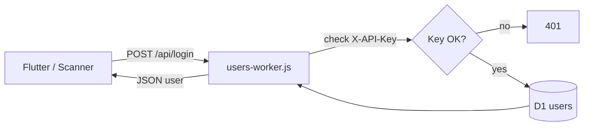
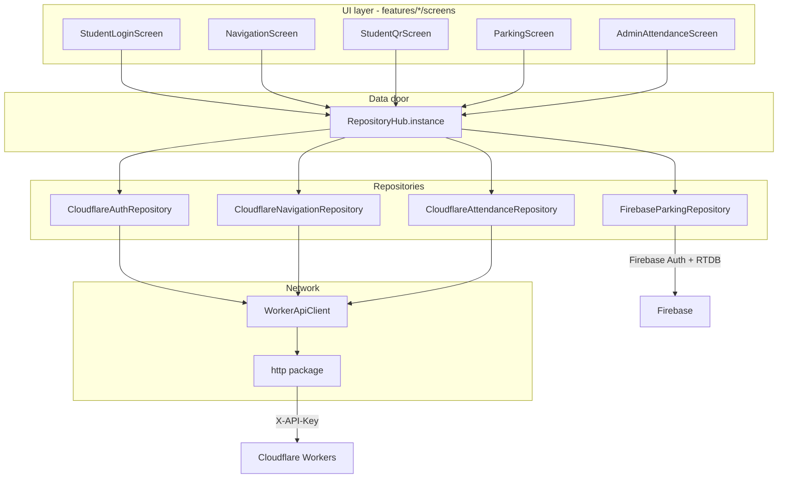
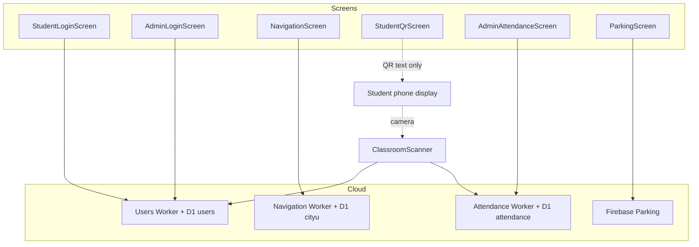

<!--
  Author / Project Supervisor : Omar Terro
  GitHub                      : https://github.com/IOTERRO
  Website                     : https://omarterro.fr
  Student (FYP)               : Khaled Othman
  Project                     : SmartUni - Smart University CityU
-->

# SmartUni — Complete architecture & code guide

This document explains **the whole project as it works today**: Cloudflare, Flutter screens, repositories, Classroom Scanner, and parking IoT.

You do **not** need to know the project history. Everything here matches the **live** code.

| | |
|--|--|
| **Author / Project Supervisor** | Omar Terro — [IOTERRO](https://github.com/IOTERRO) · [omarterro.fr](https://omarterro.fr) |
| **Student (FYP)** | Khaled Othman |
| Short version | [`OVERVIEW.md`](./OVERVIEW.md) |

---

## How to read this document

| If you want… | Go to |
|--------------|--------|
| What Cloudflare is and how APIs work | [Part A](#part-a--cloudflare-architecture) |
| How Flutter talks to Cloudflare (the “bridge”) | [Part B](#part-b--how-flutter-connects-to-cloudflare) |
| Every Frontend folder & file | [Part C](#part-c--frontend-smartuni--folders--files) |
| How each screen is programmed + which API it calls | [Part D](#part-d--screens--how-they-are-programmed) |
| Classroom Scanner (QR reader) | [Part E](#part-e--classroom-scanner-app) |
| Parking ESP32 + Firebase | [Part F](#part-f--parking-iot--firebase) |
| Words glossary | [Part G](#part-g--glossary-for-beginners) |

---

# Part A — Cloudflare architecture

## A.1 What is Cloudflare in this project?

Think of three pieces:

```text
┌──────────────┐     HTTPS + X-API-Key      ┌─────────────────┐      SQL      ┌──────────┐
│ Flutter apps │  ────────────────────────► │ Cloudflare      │ ───────────► │ D1       │
│ (phone/web)  │  ◄──────────────────────── │ Worker (JS)     │ ◄─────────── │ database │
└──────────────┘     JSON response          │ “the API door”  │              │ (tables) │
                                            └─────────────────┘              └──────────┘
```

| Piece | Simple meaning |
|-------|----------------|
| **Worker** | A small JavaScript program that runs in the cloud. It receives HTTP requests (`GET`, `POST`), checks the API key, talks to the database, returns JSON. |
| **D1** | Cloudflare’s SQL database (like SQLite online). Tables store users, locations, attendance rows. |
| **Secret `API_KEY`** | A password shared between Flutter (`secrets.dart`) and the Worker. Sent in header `X-API-Key`. Without it → `401 Unauthorized`. |

We use **three Workers** (three doors), each with its **own D1 database**:

| Worker script | Public URL (example) | D1 name | What it stores |
|---------------|----------------------|---------|----------------|
| `Backend/worker/users-worker.js` | `https://users.khaledothman750.workers.dev` | `users` | Usernames, passwords, roles |
| `Backend/worker/navigation-worker.js` | `https://navigation.khaledothman750.workers.dev` | `cityu` | Campus places + walking edges |
| `Backend/worker/attendance-worker.js` | `https://smart-university.khaledothman750.workers.dev` | `smart-university-db` | Courses, sessions, present/absent |

SQL templates (source of truth): `Backend/sql/users_d1_schema.sql`, `locations_d1_schema.sql`, `attendance_d1_schema.sql`.

## A.2 What happens on one API call? (example: login)

```text
1. Flutter builds URL:  https://users....workers.dev/api/login
2. Flutter sends POST with headers:
      Content-Type: application/json
      X-API-Key: <from secrets.dart>
   and body:
      { "username": "student", "password": "student" }

3. Worker authorize() compares X-API-Key to env.API_KEY
4. Worker runs SQL on D1: SELECT * FROM users WHERE username = ?
5. If password matches → JSON:
      { "success": true, "user": { "id": ..., "role": "student", ... }, "token": "demo-..." }
6. Flutter maps "user" → AppUser and opens Student home
```

Same pattern for navigation and attendance — only the URL and path change.

## A.3 Users Worker — architecture

**File:** `Backend/worker/users-worker.js`



| Endpoint | Method | Purpose |
|----------|--------|---------|
| `/api/login` | POST | Check username/password, return `user` |
| `/api/users` | GET/POST | List / create users |
| `/api/users/:id` | GET/PUT/DELETE | One user |
| `/api/health` | GET | Service alive? |

**Main table `users` (conceptually):** `id`, `username`, `password`, `full_name`, `email`, `role` (`student`/`admin`), `faculty`, `is_active`, …

Demo accounts: `student`/`student`, `admin`/`admin`.

## A.4 Navigation Worker — architecture

**File:** `Backend/worker/navigation-worker.js`

| Endpoint | Purpose |
|----------|---------|
| `GET /api/locations` | All campus places |
| `GET /api/locations/search?q=` | Search by name/code |
| `GET /api/navigation?from=&to=` | Shortest path using `location_edges` |

**Tables:**

- `locations` — buildings / rooms (id, name, lat, lng, …)
- `location_edges` — walkable links (from_id, to_id, distance)

Flutter maps each JSON row → `CampusLocation` model.

## A.5 Attendance Worker — architecture

**File:** `Backend/worker/attendance-worker.js`

| Endpoint | Purpose |
|----------|---------|
| `GET /api/attendance/sessions` | List class sessions |
| `GET /api/attendance/records?session_id=` | Who is Present/Absent |
| `POST /api/attendance/scan` | Classroom device marks Present |

**Tables:**

- `courses` — e.g. NET301
- `attendance_sessions` — one class meeting (`id`, `course_id`, `session_date`, `start_time`, `room`, `is_active`)
- `attendance_records` — one row per student per session (`student_id`, `status`, `scanned_at`, `qr_token`, `device_id`, `created_at`, …)

**Scan body (from Classroom Scanner):**

```json
{
  "session_id": "SES-NET301-20261013-0900",
  "qr_raw": "SMARTUNI|SID:student|TOK:ABC123|EXP:1739000000000",
  "device_id": "CLASSROOM-SCANNER-01"
}
```

Worker parses `qr_raw`, checks expiry, upserts `status = Present`.

## A.6 Cloudflare vs parking (important)

Parking does **not** use Cloudflare. It uses **Firebase Realtime Database** + ESP32. See [Part F](#part-f--parking-iot--firebase).

---

# Part B — How Flutter connects to Cloudflare

## B.1 The golden rule

**Screens never call Cloudflare URLs directly.**

```text
Screen  →  RepositoryHub  →  Repository (Cloudflare*)  →  WorkerApiClient  →  Cloudflare Worker
```

Why? So you can switch mock ↔ live by changing one place (`RepositoryHub` + `AppConfig` flags) without rewriting every screen.

## B.2 Layer diagram (Frontend)



## B.3 File: `WorkerApiClient` (the HTTP bridge)

**Path:** `Frontend/lib/data/remote/worker_api_client.dart`

What it does, in plain words:

1. Remembers `baseUrl` (e.g. users Worker URL) and `apiKey`.
2. On every request, adds headers including `X-API-Key`.
3. `get(path)` / `post(path, body)` call the Worker.
4. Reads JSON. If `success == false` or HTTP ≥ 400 → throws `ApiException` with the Worker’s `error` message.
5. Otherwise returns the `Map` so the repository can read `user` or `data`.

**Classroom Scanner has its own copy:** `ClassroomScanner/lib/data/worker_api_client.dart` (same idea).

## B.4 File: `RepositoryHub` (the switchboard)

**Path:** `Frontend/lib/data/repositories/repository_hub.dart`

```dart
static final RepositoryHub instance = RepositoryHub._(
  auth: AppConfig.useCloudflareApis
      ? CloudflareAuthRepository()
      : MockAuthRepository(),
  navigation: AppConfig.useCloudflareApis
      ? CloudflareNavigationRepository()
      : MockNavigationRepository(),
  attendance: AppConfig.useCloudflareApis
      ? CloudflareAttendanceRepository()
      : MockAttendanceRepository(),
  parking: AppConfig.parkingUsesFirebase
      ? FirebaseParkingRepository()
      : MockParkingRepository(),
);
```

Screens call: `RepositoryHub.instance.auth.loginStudent(...)`.

## B.5 Config & secrets (where URLs and keys live)

| File | Contains |
|------|----------|
| `Frontend/lib/core/config/app_config.dart` | Worker URLs, Firebase URL, flags `useCloudflareApis`, `parkingUsesFirebase`, QR/parking timers |
| `Frontend/lib/core/config/secrets.dart` | Real API keys (**gitignored**) |
| `Frontend/lib/core/config/secrets.example.dart` | Template committed to git |

Today’s flags:

- `useCloudflareApis = true` → login, navigation, attendance use Workers  
- `parkingUsesFirebase = true` → parking uses Firebase  
- `designMode = false` → yellow “design mode” banners hidden  

## B.6 Mapping: screen action → Cloudflare

| User action on screen | Repository method | Worker | Path |
|----------------------|-------------------|--------|------|
| Student Sign In | `auth.loginStudent` | Users | `POST /api/login` |
| Admin Sign In | `auth.loginAdmin` | Users | `POST /api/login` |
| Open Navigation / load places | `navigation.fetchLocations` | Navigation | `GET /api/locations` |
| Search place | `navigation.search` | Navigation | `GET /api/locations/search?q=` |
| Find route | `navigation.findRoute` | Navigation | `GET /api/navigation?from=&to=` |
| Admin attendance sessions | `attendance.fetchSessions` | Attendance | `GET /api/attendance/sessions` |
| Admin attendance records | `attendance.fetchRecords` | Attendance | `GET /api/attendance/records?session_id=` |
| Student show QR | `attendance.generateStudentQr` | *(none — local)* | builds `SMARTUNI\|…` string |
| Scanner login | `ScannerApi.loginInstructor` | Users | `POST /api/login` |
| Scanner scan | `ScannerApi.submitScan` | Attendance | `POST /api/attendance/scan` |
| Parking list | `parking.fetchSummary` | *(Firebase, not CF)* | RTDB GET |

---

# Part C — Frontend (SmartUni) — folders & files

## C.1 Entry point

### `lib/main.dart`

- Starts Flutter (`WidgetsFlutterBinding.ensureInitialized()`).
- Installs error handlers so web shows a red error text instead of a blank page.
- Calls `runApp(const SmartUniApp())`.

### `lib/app/smart_uni_app.dart`

- Builds `MaterialApp` with theme, title, **first route = welcome**, and `onGenerateRoute: AppRouter.onGenerateRoute`.

### `lib/app/router/app_routes.dart`

Named path strings, e.g.:

- `/` welcome  
- `/login/student`, `/login/admin`  
- `/student`, `/guest`, `/admin`  
- `/navigation`, `/attendance/qr`, `/parking`  
- `/admin/navigation`, `/admin/attendance`, `/admin/parking`  

### `lib/app/router/app_router.dart`

`switch (settings.name)` → returns the correct **screen widget**. This is how navigation between pages works.

### Theme

- `lib/app/theme/app_colors.dart` — color constants  
- `lib/app/theme/app_theme.dart` — Material theme using those colors  

## C.2 Core (shared building blocks)

| File | What it does |
|------|----------------|
| `core/config/app_config.dart` | Non-secret settings (URLs, flags, timers) |
| `core/config/secrets.dart` | API keys (local only) |
| `core/config/secrets.example.dart` | Template for secrets |
| `core/session/session_controller.dart` | Remembers who is logged in **in RAM** (`setUser`, `clear`, `continueAsGuest`) |
| `core/enums/user_role.dart` | `guest`, `student`, `admin` |
| `core/models/app_user.dart` | User object; `fromWorkerJson` maps Cloudflare login JSON |
| `core/models/campus_location.dart` | One map place; `fromWorkerJson` |
| `core/models/student_qr_payload.dart` | QR fields + `encoded` string `SMARTUNI\|SID:\|TOK:\|EXP:` |
| `core/models/parking_slot.dart` | Parking bay; `fromFirebaseJson` |
| `core/constants/app_constants.dart` | Demo usernames shown on login UI |
| `core/attribution.dart` | Supervisor / student credit strings |
| `core/widgets/*` | Reusable UI: text fields, cards, section headers, design banner |

### Session (important for beginners)

`SessionController` is a **singleton** (`SessionController.instance`). After login, the screen calls `setUser(user)`. Other screens read `SessionController.instance.user` to show the name. Closing the app clears it (not saved to disk yet).

## C.3 Data layer — every repository file

| File | Role |
|------|------|
| `data/remote/worker_api_client.dart` | HTTP + `X-API-Key` + JSON errors |
| `data/repositories/repository_hub.dart` | Creates the live (or mock) implementations |
| `data/repositories/auth_repository.dart` | **Abstract** login API + `MockAuthRepository` |
| `data/repositories/cloudflare_auth_repository.dart` | **Live** login → Users Worker |
| `data/repositories/navigation_repository.dart` | Abstract locations/route + mock |
| `data/repositories/cloudflare_navigation_repository.dart` | **Live** navigation → Navigation Worker |
| `data/repositories/attendance_repository.dart` | Abstract QR + sessions/records; includes `MockAttendanceRepository` + `CloudflareAttendanceRepository` |
| `data/repositories/parking_repository.dart` | Abstract parking summary + mock |
| `data/repositories/firebase_parking_repository.dart` | **Live** parking → Firebase |
| `data/mock/mock_data.dart` | Fake campus data if mocks are enabled |

### How `CloudflareAuthRepository` works (step by step)

1. Builds `WorkerApiClient(baseUrl: usersWorkerUrl, apiKey: usersWorkerApiKey)`.
2. `loginStudent` → `_login` → `POST /api/login` with username/password.
3. Reads `json['user']` → `AppUser.fromWorkerJson`.
4. Checks role is `student` (admin login checks `admin`).
5. On network/API failure → `AuthException` with a human message for the SnackBar.

### How `CloudflareNavigationRepository` works

1. Client pointed at **navigation** Worker URL + key.
2. `fetchLocations` → `GET /api/locations` → list of `CampusLocation`.
3. `search` → `GET /api/locations/search?q=...`.
4. `findRoute` → `GET /api/navigation?from=&to=` → path list + distance.

### How `CloudflareAttendanceRepository` works

1. Client pointed at **attendance** Worker.
2. `fetchSessions` / `fetchRecords` → GET APIs (used by admin UI).
3. `generateStudentQr` does **not** call the cloud — it creates a random token locally (same helper as mock). The cloud learns about the student when the **scanner** posts `qr_raw`.

## C.4 Features folder map

```text
lib/features/
├── auth/screens/       Welcome, student login, admin login
├── guest/screens/      Guest home
├── student/screens/    Student home, profile
├── admin/screens/      Admin home + module screens
├── navigation/screens/ Shared NavigationScreen
├── attendance/screens/ Student QR screen
└── parking/screens/    Parking screen
```

### `lib/_legacy/`

Old prototype screens. **`main.dart` does not use them.** Ignore while learning.

---

# Part D — Screens: how they are programmed

Each screen is a Flutter `Widget` (usually `StatefulWidget` if it has text fields, loading, or timers).

Typical pattern:

1. User taps a button.  
2. `setState` → show loading spinner.  
3. `await RepositoryHub.instance....`  
4. On success → update session / UI or `Navigator.pushNamed(...)`.  
5. On `AuthException` / `ApiException` → `SnackBar` with message.  
6. `setState` → hide loading.

## D.1 Welcome → role choice

**File:** `features/auth/screens/welcome_screen.dart`

- Buttons: Continue as Guest / Student login / Admin login.
- Guest: `SessionController.instance.continueAsGuest()` then go to `AppRoutes.guestHome`.
- Student/Admin: only navigate to login screens (no Cloudflare yet).

## D.2 Student login → Cloudflare Users

**File:** `features/auth/screens/student_login_screen.dart`

```text
User taps Sign In
  → RepositoryHub.instance.auth.loginStudent(universityId, password)
      → CloudflareAuthRepository
          → WorkerApiClient POST users.../api/login
              → D1 users table
  → SessionController.setUser(user)
  → Navigator → StudentHomeScreen
```

UI pieces: two `AppTextField`s, password visibility toggle, `ElevatedButton`, loading `CircularProgressIndicator`.

**Admin login** (`admin_login_screen.dart`) is the same pattern with `loginAdmin` and route `AppRoutes.adminHome`.

## D.3 Student / Guest / Admin homes

| File | Programmed behaviour |
|------|----------------------|
| `student_home_screen.dart` | Shows service cards; navigates to navigation / QR / parking / profile; logout clears session |
| `guest_home_screen.dart` | Only navigation card |
| `admin_home_screen.dart` | Cards for admin navigation, attendance, parking modules |

Homes **do not** call Cloudflare themselves; child screens do.

## D.4 Navigation screen → Cloudflare Navigation

**File:** `features/navigation/screens/navigation_screen.dart`

Typical flow:

1. `initState` / load → `RepositoryHub.instance.navigation.fetchLocations()`.
2. User searches → `navigation.search(query)`.
3. User picks From / To → `navigation.findRoute(fromId, toId)`.
4. UI draws the path / distance from the returned `NavigationRoutePreview`.

Used by **Guest and Student** (same screen).

## D.5 Student QR screen → local QR (Cloudflare later via scanner)

**File:** `features/attendance/screens/student_qr_screen.dart`

1. Reads current user from `SessionController`.
2. Calls `RepositoryHub.instance.attendance.generateStudentQr(user)`.
3. Shows QR image from `payload.encoded`.
4. Timer (~every second) counts down; every ~20s regenerates a new token (`AppConfig.studentQrRefreshInterval`).

**No attendance Worker call here.** The connection to Cloudflare happens when Classroom Scanner posts the scan.

## D.6 Admin attendance → Cloudflare Attendance

**File:** `features/admin/screens/admin_attendance_screen.dart`

1. Loads sessions: `attendance.fetchSessions()`.
2. When a session is selected, loads records: `attendance.fetchRecords(sessionId)`.
3. Shows Present/Absent list from D1.

Creating sessions may also use Worker POST endpoints depending on the screen actions — data always goes through the attendance repository / Worker.

## D.7 Parking screen → Firebase (not Cloudflare)

**File:** `features/parking/screens/parking_screen.dart`

1. Timer every 5s (`parkingRefreshInterval`).
2. `RepositoryHub.instance.parking.fetchSummary()`.
3. `FirebaseParkingRepository` signs in to Firebase (if needed), GETs RTDB JSON, maps to `ParkingSlot` list.
4. UI shows free/occupied for P1/P2/P3.

## D.8 Screen → Cloudflare connection summary (mermaid)



---

# Part E — Classroom Scanner app

## E.1 Why a second app?

| App | Device | Job |
|-----|--------|-----|
| Frontend | Student phone | **Show** QR |
| ClassroomScanner | Laptop / classroom phone | **Read** QR and call Attendance Worker |

## E.2 File map

```text
ClassroomScanner/lib/
├── main.dart                          Starts app → LoginScreen
├── app/theme.dart                     Colors / Material theme
├── core/attribution.dart              Credits
├── core/scan_sounds.dart              Plays success.wav / fail.wav
├── core/config/app_config.dart        Worker URLs + device_id
├── core/config/secrets.dart           API keys (gitignored)
├── core/config/secrets.example.dart   Template
├── data/worker_api_client.dart        Same idea as Frontend
├── data/scanner_api.dart              login + sessions + submitScan + QR parse
└── features/
    ├── login/login_screen.dart
    ├── sessions/session_list_screen.dart
    └── scan/scan_screen.dart
assets/sounds/success.wav
assets/sounds/fail.wav
```

## E.3 `ScannerApi` — the scanner’s “repository”

**File:** `data/scanner_api.dart`

| Method | Cloudflare |
|--------|------------|
| `loginInstructor` | Users `POST /api/login` — **rejects non-admin** |
| `fetchSessions` | Attendance `GET /api/attendance/sessions` |
| `submitScan` | Attendance `POST /api/attendance/scan` with `session_id`, `qr_raw`, `device_id` |

Also defines models: `ScannerUser`, `AttendanceSession`, `ScanResult`, and `StudentQrRaw.tryParse` for local expiry checks.

## E.4 Screen programming

### Login

UI → `api.loginInstructor` → if admin → `SessionListScreen`.

### Session list

`FutureBuilder` on `api.fetchSessions()` → list tiles → open `ScanScreen(session: ...)`.

### Scan

1. `MobileScanner` detects QR string.  
2. Ignore same string for 3 seconds.  
3. Optional: if `EXP` already past → fail sound + message.  
4. Else `api.submitScan` → Cloudflare → update OK/Fail counters + banner.  
5. `ScanSounds.playSuccess()` or `playFail()`.

## E.5 Full attendance chain (both apps + Cloudflare)

```text
Frontend StudentQrScreen
   generateStudentQr()  →  string SMARTUNI|SID|TOK|EXP
        │
        │  (shown on phone screen)
        ▼
ClassroomScanner ScanScreen camera
        │
        ▼
ScannerApi.submitScan
        │
        ▼
Attendance Worker  POST /api/attendance/scan
        │
        ▼
D1 attendance_records  status=Present
        │
        ▼
AdminAttendanceScreen can refresh and see the new Present row
```

---

# Part F — Parking IoT + Firebase

## F.1 Architecture

```text
ESP32 (iot/parking_node)
  HC-SR04 ×3  →  measure distance  →  decide free/occupied
        │
        │ Wi-Fi HTTPS
        ▼
Firebase Realtime Database
  /SmartUniversity/Parking/P1
  /SmartUniversity/Parking/P2
  /SmartUniversity/Parking/P3
        │
        │ Flutter polls every 5s
        ▼
FirebaseParkingRepository.fetchSummary()
        │
        ▼
ParkingScreen UI
```

## F.2 Important files

| Path | Role |
|------|------|
| `iot/parking_node/parking_node.ino` | Main loop |
| `iot/parking_node/ParkingSpot.h` | Spot logic |
| `iot/parking_node/Config.example.h` | Template for Wi-Fi + Firebase |
| `iot/parking_node/Config.h` | Local secrets (**gitignored**) |
| `Frontend/.../firebase_parking_repository.dart` | Sign-in + read RTDB |
| `Frontend/.../parking_screen.dart` | UI + timer |

Pins (typical): P1 TRIG/ECHO 13/14, P2 26/27, P3 32/33.

---

# Part G — Glossary for beginners

| Term | Meaning |
|------|---------|
| **Widget / Screen** | A Flutter UI page (`Scaffold`, buttons, text). |
| **StatefulWidget** | Screen that can change (loading, text typed, timer). |
| **Repository** | Class whose job is “get/save data” (not draw UI). |
| **Abstract class** | Contract (`AuthRepository`) — screens depend on this, not on Cloudflare details. |
| **Singleton** | One shared object (`RepositoryHub.instance`, `SessionController.instance`). |
| **Worker** | Cloudflare serverless API (JavaScript). |
| **D1** | Cloudflare SQL database. |
| **X-API-Key** | Shared secret header so random people cannot call your Worker. |
| **JSON** | Data format `{ "success": true, "data": ... }` exchanged with Workers. |
| **Mock** | Fake data inside the app (still available if flags are turned off). |
| **QR payload** | Text inside the QR: `SMARTUNI\|SID:…\|TOK:…\|EXP:…`. |
| **RTDB** | Firebase Realtime Database (parking). |

---

# Quick checklist: “I understand SmartUni if I can explain…”

1. Three Cloudflare Workers + three D1 databases, all protected by `X-API-Key`.  
2. Screens → `RepositoryHub` → `Cloudflare*Repository` → `WorkerApiClient` → Worker.  
3. Student QR is local; Scanner posts it to Attendance Worker.  
4. Parking is ESP32 → Firebase → Flutter (not Cloudflare).  
5. `ClassroomScanner/` is a second app for the classroom camera.  
6. `lib/_legacy/` is old and unused.

---

## Related files outside this doc

| Path | Content |
|------|---------|
| [`OVERVIEW.md`](./OVERVIEW.md) | Short non-technical summary |
| [`../Backend/sql/`](../Backend/sql/) | Exact D1 `CREATE TABLE` scripts |
| [`../Backend/worker/worker_results_tests.md`](../Backend/worker/worker_results_tests.md) | Example curl / PowerShell API tests |
| [`07_ANDROID_WIRELESS_ADB.md`](./07_ANDROID_WIRELESS_ADB.md) | Run Flutter on phone over Wi‑Fi |
| `Backend/worker/*_README.md` | Per-Worker deploy notes |
| `ClassroomScanner/README.md` | Scanner setup commands |
| `iot/parking_node/README.md` | ESP32 flash / pins |

---

*Author / Project Supervisor: Omar Terro — [IOTERRO](https://github.com/IOTERRO) · [omarterro.fr](https://omarterro.fr)*  
*Student (FYP): Khaled Othman*
